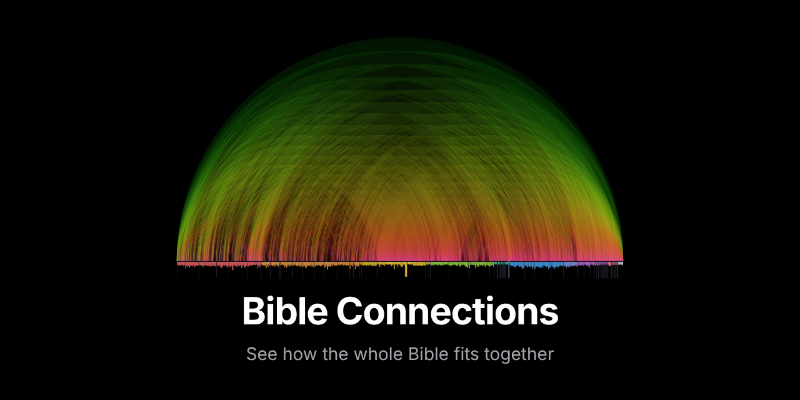

<h1>Bible Connections</h1>

<strong>An interactive map of the cross references in the Bible.</strong> 
Every arc joins two passages that point to each other, from Genesis on the left to Revelation on the right.

Created by <a href="https://github.com/JoeMighty">JoeMighty</a>

  
  
  
  

  
  
  

  
  
  
  

  
  
  
  

<a href="https://joemighty.github.io/BibleConnections/"><strong>Open the live site</strong></a>

No Bible translation is published on this site. Every passage links out to [Bible.com](https://www.bible.com) in the reader's chosen translation (NIV by default). The only Scripture text shown is the original Hebrew, Aramaic and Greek, from STEP Bible under CC BY 4.0.

## Features

### Explore the map
- **Map:** 199,275 cross references with a strength slider, zoom (scroll, pinch, buttons, keyboard) and pan. Uses WebGL where a graphics chip is available.
- **Welcome page:** a picture of the full map with an Old and New Testament timeline, search, connection of the day, themes, the current sermon series and "pick up where you left off".
- **Connections:** tap any arc to see both passages and open them on Bible.com.
- **Why it connects:** 362 short explanations for the strongest links, with a filter to show only explained connections.
- **Search:** references (`John 3:16`, `Psalm 23`, `Juan 3:16`) or words (`shepherd`).
- **Filters:** Old/New Testament, 10 categories, single books and 12 themes, with a "You're viewing" bar and Start over.
- **Chronological view:** rearrange the books by when their events happen.
- **How are these connected?:** the shortest chain of cross references between any two passages, animated on the map.
- **Shared connections:** pick two passages and find the passages they both link to.

### Study
- **Passage explorer:** open any verse to see its original Hebrew, Aramaic or Greek words, its place in the chapter, an introduction to the book (all 66), connections split by Testament, people, places and topics, reflection questions and your own notes.
- **Word study:** about 14,000 Hebrew, Aramaic and Greek words (from STEP Bible) with pronunciation, Strong's numbers, meanings by context, where they are used, grammatical forms, related words and the full dictionary entry.
- **Words in common:** every connection shows the Hebrew and Greek words both passages share, across the two Testaments too.
- **Chapter and book study:** key original words, places on a map, the book's introduction and reflection questions for any chapter or book.
- **Places on a map:** 1,277 places from OpenBible.info on an offline map of the Bible lands and of Israel, with every verse that mentions each place.
- **My notes:** private notes on any verse, kept on the device only, with export and import.
- **Back up everything:** notes, saved items, collections, plan progress and settings in one file, restored on any device.
- **Study hub:** 3 reading plans with saved progress and calendar reminders, 56 people and places, 42 topics, a "Guess the connection" game for groups, insights and a printable poster.
- **Connection of the day:** on the welcome page, and as a daily calendar and RSS feed.

### Read and listen
- **Bible.com links:** 99 translations in 31 languages, with a searchable picker. Choose a reading translation and an optional second one to compare, right in the sidebar.
- **Listen:** a headphones button opens the chapter in Bible.com's audio Bible for the 65 translations that have one.

### Teach and share
- **Guided journeys:** 12 step-by-step tours (3 written for children) with discussion questions, presenter mode for sermons and classes (works with clickers).
- **Share a verse study as an image:** a ready-made picture with the reference, original words, connections and a question.
- **Printable handouts:** for any journey, and for any verse (book introduction, original words, strongest connections, reflection questions and space for notes).
- **Sermon series:** show the current series passages on the welcome page.
- **Collections:** group connections and verses for a sermon or small group and share them as one link.
- **Sharing:** every view has its own link, back button support, Share, Copy, Save image, story-sized images, QR codes for slides and bulletins, embed code for church websites, and link previews in messaging apps.
- **Community notes:** a "Suggest a note" link on any connection without one opens a ready-made GitHub form.

### For everyone
- **Kids mode:** bigger text, simpler words and journeys written for children.
- **Spanish:** full Spanish interface, journeys, book introductions, questions and handouts.
- **Settings:** language, light, dark or system appearance, text size, an easier-to-read font, high contrast mode and Bible.com translations.
- **Easy tapping on phones:** where several arcs lie close together, a short list lets you pick the one you meant.
- **Saved and recent:** save items and see recently viewed, stored on the device only.
- **Installable and offline:** works as an app and without a connection after the first visit. Studied passages are saved as you go, and **Save for offline** downloads all the original language text, word studies and places at once (Bible.com links still need the internet).
- **Accessible:** keyboard support, screen reader announcements, list alternatives to the map, 44px touch targets, reduced motion support, tested with axe in both languages and themes.

## More guides

- [Usage stats (optional)](docs/ANALYTICS.md)
- [Accessibility testing with real users](docs/ACCESSIBILITY-TESTING.md)
- [Growing the reach of the project](docs/PROMOTION.md)
- [Content review packet for pastors](docs/THEOLOGY-REVIEW.md)

## Contributing

Suggestions for notes, journeys, themes and translations are very welcome. See [CONTRIBUTING.md](CONTRIBUTING.md), or open an issue using one of the forms.

## Changelog

See [CHANGELOG.md](CHANGELOG.md) for what changed in each version, and [Releases](https://github.com/JoeMighty/BibleConnections/releases) for each published version.

## License and credit

Bible Connections is created by [JoeMighty](https://github.com/JoeMighty).

- **Code:** [Apache License 2.0](LICENSE), with the [NOTICE](NOTICE) file.
- **Notes, journeys, book introductions, questions, themes, translations and guides:** [CC BY 4.0](LICENSE-CONTENT.md).

GitHub also shows a **Cite this repository** button (from [CITATION.cff](CITATION.cff)).

## Sources and licenses

Full details are in [THIRD_PARTY_NOTICES.md](THIRD_PARTY_NOTICES.md).

- Cross references: [OpenBible.info](https://www.openbible.info/labs/cross-references/), [CC BY 4.0](https://creativecommons.org/licenses/by/4.0/)
- Hebrew, Aramaic and Greek text, word data and lexicons: [STEP Bible](https://www.stepbible.org) (Tyndale House), [CC BY 4.0](https://creativecommons.org/licenses/by/4.0/). Dictionary entries from Brown-Driver-Briggs and Abbott-Smith (public domain)
- Places: [OpenBible.info Bible Geocoding Data](https://www.openbible.info/geo/), [CC BY 4.0](https://creativecommons.org/licenses/by/4.0/). Coastline: [Natural Earth](https://www.naturalearthdata.com) (public domain)
- Verse counts and word index: [Berean Standard Bible](https://berean.bible/) (public domain), via [scrollmapper/bible_databases](https://github.com/scrollmapper/bible_databases)
- Reading and listening links: [Bible.com](https://www.bible.com) (not affiliated)
- Easier-to-read font: [Atkinson Hyperlegible](https://www.brailleinstitute.org/freefont/) by the Braille Institute, [SIL Open Font License](https://openfontlicense.org)
- Inspired by the cross reference visualization by Chris Harrison and Christoph Römhild
